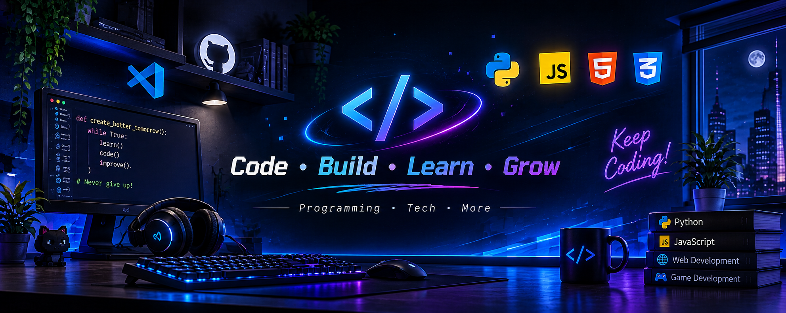

 

  

#  👋 Hey, I'm AmirAli!

💻 Developer in Progress | 🎮 Gamer | 🚀 Tech Enthusiast

I enjoy building websites, exploring new technologies, and creating cool projects.

### 💫 About Me
- 🔭 Working on web development projects
- 🌱 Learning Python, JavaScript, HTML & CSS
- 🎮 Interested in gaming and technology
- ⚡ Always learning something new!

### 🛠️ Tech Stack

### 🚀 Featured Projects

| Project | Description |
|---|---|
| 🦸 [SuperManPanel](https://github.com/amiralidlb93-hash/SuperManPanel) | A VPN management panel project built for Railway deployment |
| ⚡ [AmneziaWG Config Generator](https://github.com/amiralidlb93-hash/-AmneziaWG-Config-Generator) | A browser-based tool for generating AmneziaWG configurations |
| 📚 [Vajegardon](https://github.com/amiralidlb93-hash/vajegardon) | A bilingual Persian-English 3D dictionary with quizzes and flashcards |
| 👻 [Nights Of Ghosts](https://github.com/amiralidlb93-hash/Nights-Of-Ghosts) | A Persian Halloween browser game built with Canvas and JavaScript |
| 🏠 [AmirAli HQ](https://github.com/amiralidlb93-hash/amirali-hq) | A personal website featuring pinned projects and a live repository list |
### 📊 GitHub Stats

### 📊 GitHub Stats & Top Languages

  
  

### 🔥 GitHub Streak

  

---

⭐ Thanks for visiting my profile!

*Keep learning. Keep building. Keep creating.*
